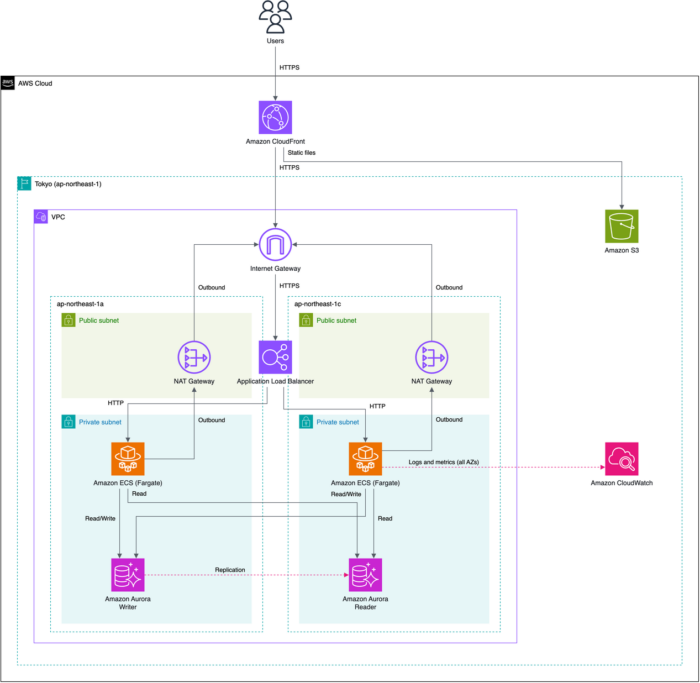
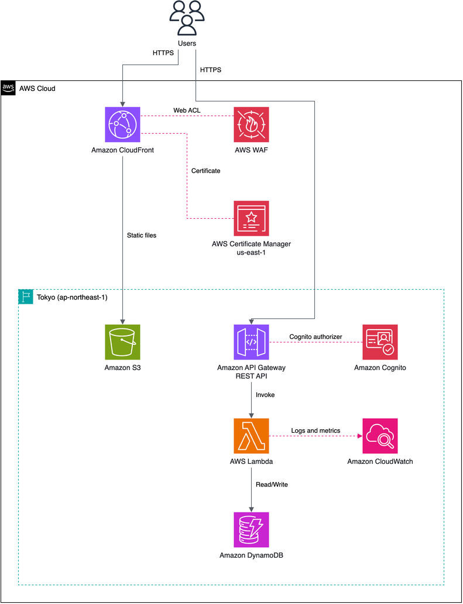
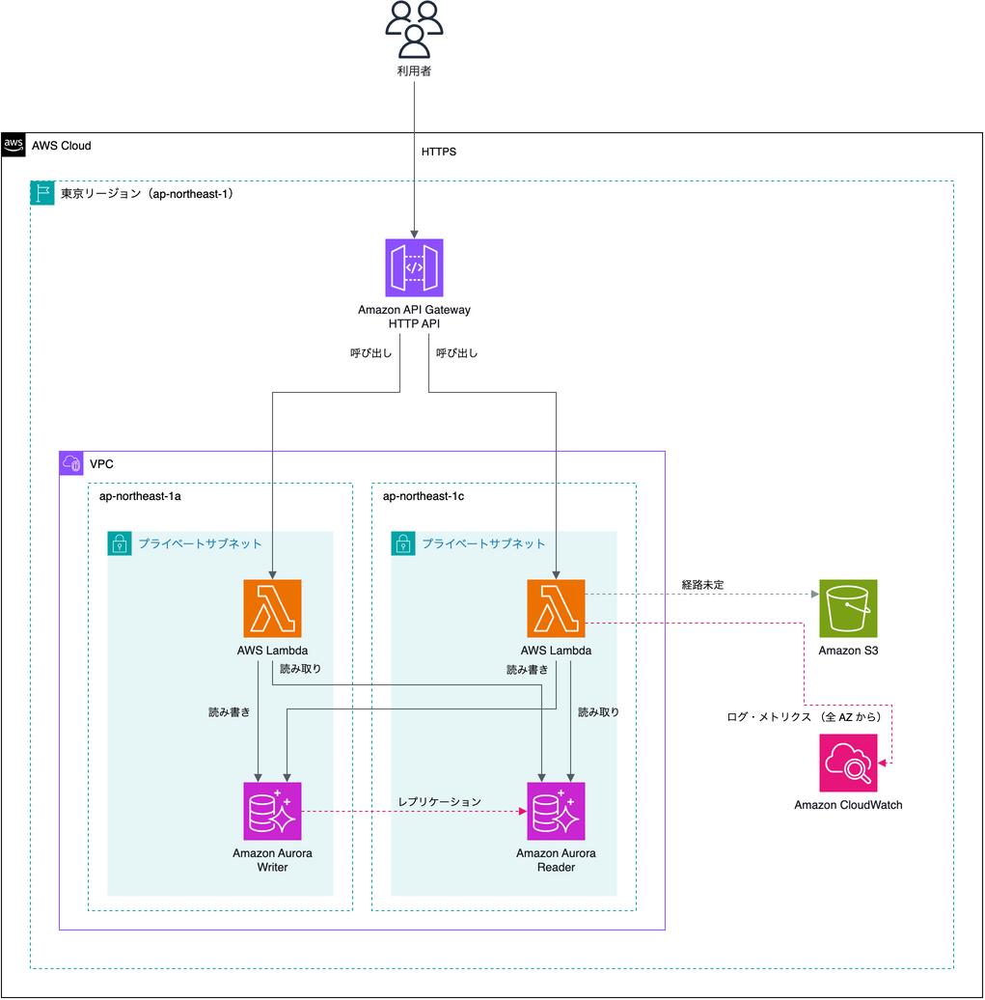

# archwire

[English](README.md)

archwire は、サービスどうしのつながりを短く書いた定義から、AWS の構成図を draw.io の形式で組み立てる。AI ではなく規則で動く。同じ定義からは、macOS でも Linux でも1バイトも違わない同じ図が出る。archwire が自分で足した部品や設定には必ず理由が付く。つながりだけでは構成が決まらないところは、推測で埋めずに穴として返し、答えを求める。

archwire は AWS の公式ツールではなく、Amazon Web Services とは提携していない。

## 例

次の内容を `web.yaml` として保存する。

```yaml
flows:
  - user -> cloudfront -> alb -> ecs(fargate) -> aurora
  - cloudfront -> s3
  - ecs -> internet
  - ecs ~> cloudwatch
```

```sh
archwire compile web.yaml -o web.drawio
```

コマンドは `web.drawio` を書き出し、JSON のレポートを表示する。終了コードは0。図はこうなる。



定義は4行しかないのに、VPC、Internet Gateway、パブリックとプライベートのサブネット、2つ目の Availability Zone、NAT gateway、Aurora のライターとリーダーができている。どれも定義には書いていない。それぞれにレポートの中で理由が付き、同じ理由が `.drawio` ファイルの中の部品にも入っている（[レポートの読み方](#レポートの読み方)を参照）。

この例で理由を持つのは、AWS Cloud の枠、リージョンの枠、VPC の枠、2つの Availability Zone の枠、4つのサブネットの枠すべて、Internet Gateway、2つの NAT gateway、それに archwire が置き場所を選んだ部品（CloudFront、ECS、Aurora、S3、CloudWatch）。利用者とロードバランサーには理由が付かない。

### VPC の無い API

VPC に置くサービスを書かない定義は、VPC なしで描かれる。次の内容を `api.yaml` として保存する。

```yaml
flows:
  - user -> cloudfront -> s3
  - user -> apigateway(rest) -> lambda -> dynamodb
  - cognito -- apigateway
  - lambda ~> cloudwatch
  - waf -- cloudfront
  - acm -- cloudfront
set:
  lang: en
```

```sh
archwire compile api.yaml -o api.drawio
```

終了コードは0。図はこうなる。



Cognito からの線のラベルは「Cognito authorizer」になる。API が REST API だからで、`apigateway(http)` にすると「JWT authorizer」になる。Certificate Manager には名前の下に `us-east-1` と書かれる。レポートには、AWS Cloud とリージョンの枠、リージョン、各部品の置き場所、オーソライザーの理由が載る。

### VPC に入る関数

Aurora へ本流を送る Lambda 関数は、Aurora のある VPC に接続される。次の内容を `mix.yaml` として保存する。

```yaml
flows:
  - user -> apigateway(http) -> lambda -> aurora
  - lambda -> s3
  - lambda ~> cloudwatch
set:
  lang: ja
```

```sh
archwire compile mix.yaml -o mix.drawio
```

終了コードは2になる。関数から S3 への経路が決まっていないからだ（[穴](#穴)を参照）。図はこうなり、ラベルは日本語で出る。



関数は各ゾーンのプライベートサブネットに1つずつ描かれ、それぞれの写しがライターを読み書きし、リーダーを読む。API Gateway、S3、CloudWatch は VPC の外に残る。ここにはパブリックサブネットに置く部品が無いので、VPC にはプライベートサブネットしか無い。レポートに載る理由は3つある。VPC があるのは、Aurora DB クラスターを VPC の中にしか作れないから。ゾーンが2つなのは、その DB サブネットグループが少なくとも2つのゾーンにまたがるから。関数がプライベートサブネットにあるのは、Aurora に届くために VPC に接続されるから。この定義と出るべき出力は、受け入れの例 `tests/cases/mix-vpc-ja` にある。

### 向き

ここまでの図は上から下に流れている。定義が向きについて何も書いていなければこうなる。本流を左から右に描きたいときは、`set` の下に `direction: right` を足す。VPC の中はどちらでも変わらず、Availability Zone が横に並び、パブリックサブネットがプライベートサブネットの上に来る。`direction: right` を付けた `api.yaml` は受け入れの例 `tests/cases/api-rest-en` で、VPC を左から右に描いた例は `tests/cases/web-2az-ja-right` と `tests/cases/mix-vpc-ja-right` にある。各部品の置き場所は [`docs/definition.md`](docs/definition.md#how-the-parts-are-laid-out-with-a-vpc) に書いてある。

## インストール

archwire は Rust のプログラム。最近の安定版の Rust ツールチェーンがあれば、このリポジトリをチェックアウトした場所で次を実行する。

```sh
cargo install --path crates/archwire
```

## 使い方

```sh
archwire compile <definition> -o <diagram.drawio>
archwire set <definition> <place> <value>
```

`compile` は定義を読み、図を書き出し、レポートを JSON で標準出力に表示する。定義に誤りがあれば図は書き出さず、以前の compile が `-o` の場所に残したファイルも消す。古い図を結果と取り違えないようにするためだ。

`set` は定義ファイルの1か所を書き換え、ほかの行、コメント、改行コードはそのまま残す。成功すると何も表示しない。失敗すると誤りを載せたレポートを表示し、終了コード1で終わる。場所は `flows[i][j]`（i 番目の流れの行の j 番目の部品。0から数える）、`set.<key>`、`choose.<hole id>` のどれか。たとえば `web.yaml` で Availability Zone を3つにするにはこうする。

```sh
archwire set web.yaml set.azs 3
```

定義の書き方は [`docs/definition.md`](docs/definition.md) にある。

### 終了コード

| コード | 意味 |
|---|---|
| 0 | 図を書き出し、決まっていないことは何も残っていない。 |
| 1 | 定義かファイルに誤りがある。図は書き出さない。レポートは表示する。 |
| 2 | 図を書き出したが、穴が少なくとも1つ残っている。 |

### 穴

穴は、つながりだけでは決められない判断を指す。この版には2種類ある。

1つ目は VPC から出る経路。VPC のプライベートサブネットにある部品（ECS、EC2、Aurora、VPC に接続された関数）から VPC の外のリージョンのサービスへ本流が出るとき、たとえば `ecs -> s3` や `mix.yaml` の `lambda -> s3` では、通信は VPC エンドポイントからも NAT gateway からも出られる。archwire はどちらも選ばない。次の内容を `hole.yaml` として保存し、compile する。

```yaml
flows:
  - user -> alb -> ecs
  - ecs -> s3
```

```sh
archwire compile hole.yaml -o hole.drawio
```

終了コードは2。レポートには次が入る。

```json
"holes": [
  {
    "hole": "route.ecs.s3",
    "at": "flows[1]",
    "need": "Route from ecs to s3",
    "choices": [
      "endpoint",
      "nat"
    ]
  }
]
```

図はそれでも書き出される。決まっていない線は灰色の破線で描かれ、「Route undecided」というラベルが付く。穴には `set` で答える。

```sh
archwire set hole.yaml choose.route.ecs.s3 endpoint
```

これで定義に `choose:` の節が足され、`route.ecs.s3: endpoint` が入る。もう一度 compile すると終了コードは0になる。`nat` を選ぶと、archwire は NAT gateway を足す。`endpoint` を選ぶとアイコンは足さず、エンドポイントのアイコンは描かないと注記し、線のラベルは「(via VPC endpoint)」になる。

ドットの後に名前を付けた部品は、経路の穴の中では角カッコで囲んで書く。`mix.yaml` のすべての行で `lambda` の代わりに `lambda.api` と書くと、穴は `route.[lambda.api].s3` になる。`set` に渡すときは場所を引用符で囲む。zsh などのシェルは角カッコをファイル名のパターンとして読むので、archwire が動く前に `no matches found` で止まってしまう。

```sh
archwire set mix.yaml 'choose.route.[lambda.api].s3' endpoint
```

2つ目は API Gateway の種類。`(http)` も `(rest)` も付けずに `apigateway` と書くと、`http` と `rest` を選択肢とする穴 `kind.apigateway` が残る。次の内容を `api-hole.yaml` として保存する。

```yaml
flows:
  - user -> apigateway -> lambda
```

`archwire compile api-hole.yaml -o api-hole.drawio` は終了コード2で終わり、API Gateway の名前の下に「type undecided」と出る。答えるには `archwire set api-hole.yaml choose.kind.apigateway http` を実行するか、定義に `apigateway(http)` と書く。両方はしない。もう一度 compile すると終了コードは0になる。詳しくは [`docs/definition.md`](docs/definition.md#the-kind-of-api-gateway) を参照。

## レポートの読み方

レポートは1つの JSON オブジェクトで、次のフィールドを持つ。

`versions` には archwire の版と、規則のデータの版が入る。`derived` には archwire が自分で足したり決めたりしたものがすべて並ぶ。各項目には、対象の部品（`target`）、`added`、理由が制約（`constraint`）か既定値（`default`）か、規則の id、`set.lang` で選んだ言語の理由の文、制約ならそれを述べた AWS のドキュメントのページが入る。`added` は、対象が枠、Internet Gateway、NAT gateway のように archwire の足したものなら true で、プライベートサブネットの ECS のように定義に書いた部品の置き場所を決める理由なら false になる。`holes` には、上で見た未決の判断が並ぶ。`errors` には compile を止めたものが並び、それぞれ `code`、場所 `at`、受け取った値 `got`、決まった一覧があるときは許される値 `allowed`、`message` を持つ。`notes` には描画についての注記が入る。ある線をどのアイコン、文字、ほかの線にもかからずに描けなかったとき、またはその線のラベルをどのアイコン、文字、ほかの線にもかからない場所に置けなかったときは、注記がその線を名指しする（`edge-alb-to-s3` など）ので、そこを見に行ける。端を共有しない2本の線は、1点で曲がらないようにしてある。そこで曲がると、片方の前半ともう片方の後半が1本の線に見えてしまうからだ。それでもそうなったときは、注記が両方を名指しする。枠の辺にかからない場所が残っていなければ、線のラベルが枠の辺に重なることがある。文字は読めるので、これには注記を付けない。VPC の無い図で、同じサービスの部品がいくつも1つの部品へ同じ補助の流れ（`~>`）か関連（`--`）を送るときは、図は1本の線にまとめて「Logs and metrics (3 sources)」のように数を入れたラベルを付け、まとめた部品を注記が名指しする。

`warnings` は形式の一部だが、この版では使っておらず、常に空になる。エラーの `rule` フィールドは `null` で、`TOO_MANY_ATTACHED` のときだけ、定義が破った規則を名指しする。

制約は AWS のドキュメントに由来する。既定値は、定義が言っていないことについて archwire が選んだもので、Availability Zone を2つにする、ECS をプライベートサブネットに置く、といったものがある。既定値は AWS の要件ではない。どちらなのかは、レポートにも図にも書いてある。

理由はレポートの中だけにあるのではない。理由を持つ要素はどれも、`.drawio` ファイルの中のセルに属性 `derived`（理由の文）、`rule`、`kind`、`source` として理由を持っているので、図と一緒に持ち運べる。1つの要素に理由が複数あるときは、各属性が同じ順に ` | ` で区切って持つ。archwire が足したセル、つまりすべての枠と Internet Gateway と NAT gateway には、属性 `added="1"` も付く。定義に書いた部品のセルには、置き場所の理由を持っていても付かない。エラーコードの一覧は [`docs/definition.md`](docs/definition.md#errors) に、規則は [`docs/rules.md`](docs/rules.md) にある。

## この版で描けるもの

描けるサービスは、利用者、インターネット（外向きだけ）、CloudFront、WAF と Certificate Manager（どちらも CloudFront かロードバランサーに付ける）、Application Load Balancer、ECS、プライベートサブネットの EC2 インスタンス、Aurora、S3、CloudWatch、HTTP API か REST API としての API Gateway、Lambda、DynamoDB、Cognito ユーザープール（利用者がサインインするか、API Gateway に付ける）、検出から通知までの流れのサービス（GuardDuty、Inspector、Security Hub、Config、CloudTrail、EventBridge、SNS、Step Functions、Systems Manager）、ログ分析のサービス（Athena、Glue Data Catalog、Security Lake、Security Lake がサブスクライバーへの通知に使う SQS キュー）。Internet Gateway と NAT gateway は archwire が足すもので、定義には書けない。

`alb`、`ecs`、`ec2`、`aurora` を書いた定義は、Availability Zone が2つか3つの VPC を1つ持つ図になり、部品に応じてパブリックとプライベートのサブネットが入る。VPC には `alb.web` と `alb.admin` のように複数のロードバランサーを置ける。2つ以上あれば、Availability Zone の上に1列に並ぶ。Aurora へ本流を送る Lambda 関数はその VPC に接続され、プライベートサブネットにゾーンごとに1つずつ描かれる。それ以外の関数は VPC の外に残る。だから1つの定義に、ロードバランサーの後ろの Web 構成、Aurora に届く関数を持つ API、VPC の外の関数とテーブルを並べて書ける。この4つのサービスを書かない定義は、VPC なしで描かれる。

本流はどれも、`user` から、または自分で流れを始めるサービス（GuardDuty、Inspector、Security Hub、Config、CloudTrail、EventBridge、CloudWatch、EC2）から、本流をたどって届かなければならない。そのため、利用者のいない流れも定義に書ける。EC2 インスタンスが VPC エンドポイントを通って S3 や Systems Manager に届く流れ、GuardDuty の検出結果が Security Hub と EventBridge を通って SNS に届く流れ、CloudTrail と Security Hub が Security Lake にデータを送る流れなどだ。受け付けるつながりは、組ごとに `rules/aws/links.toml` と [`docs/definition.md`](docs/definition.md#which-connections-are-accepted) に並べてある。同じサービスの部品は、`s3.web` と `s3.uploads`、1つのロードバランサーの後ろの `ecs.web` と `ecs.admin` のように、ドットの後に名前を付けて区別できる。

図は上から下に流れ、`set.direction` で左から右にもできる。リージョンは `ap-northeast-1` だけで、ラベルは英語か、`set.lang` で日本語にする。ここに書いていないつながりや形は、間違った図を出す代わりに `UNSUPPORTED` のエラーで止まる。

## この版がやらないこと

1つの VPC に複数のロードバランサーを置いた図には、次の限界がある。ゾーンが2つで上から下の図では、ロードバランサーの列と Internet Gateway が2つ目のゾーンの上に寄り、1つ目のゾーンの上は空いたままになる（Issue #13）。プライベートサブネットの無い VPC では、ロードバランサーから VPC の外の部品への線が右隣のロードバランサーを横切り、注記がその線を名指しする。たとえば右に `alb.b` があるときの `alb.a ~> cloudwatch` がそうなる。そのロードバランサーに付けた証明書やウェブ ACL の破線も同じになる（Issue #14）。`- user -> alb.b01 -> ecs.b01` の後に `- user -> alb.b02 -> ecs.b02` と続けていく定義で、ゾーンが2つでも3つでも、どちらの向きでも数えると、ロードバランサー7つまでは線を名指しする注記なしで描け、8つからはそうした注記の付いた図になり、51からは配置が `LAYOUT_FAILED` で止まる（Issue #16）。各ロードバランサーに証明書とウェブ ACL を付けると（`- acm.b01 -- alb.b01` と `- waf.b01 -- alb.b01` のように続ける）、3つまでは線を名指しする注記なしで描け、4つからはそうした注記の付いた図になる。ロードバランサーを1つ足すごとに compile も遅くなる（Issue #17）。

1つの部品を CloudFront とロードバランサーの両方に付けることはできない。archwire は CloudFront に付ける証明書やウェブ ACL をリージョンの枠の外に、ロードバランサーに付けるものを枠の中に描くからだ。`acm.cloudfront` と `acm.alb` のように2つの部品を書く。[`docs/definition.md`](docs/definition.md#which-connections-are-accepted) を参照。

1つのロードバランサーの後ろに名前付きのサービスを多く並べると、そこから出る線が込み合う。`- user -> cloudfront -> alb -> ecs.s01 -> aurora` の後に `- alb -> ecs.s02`、`- alb -> ecs.s03` と続けていく定義で数えると、ゾーンが2つならサービス6つまで、3つなら3つまでは、線を名指しする注記なしで描ける。それより多くても図は描けるが、どのアイコン、ラベル、ほかの線も避けられなかった線を名指しする注記が付く。ゾーンが2つで51サービスから、3つで34サービスからは、配置が `LAYOUT_FAILED` で止まる。サービスを減らせば避けられる。これはこの配置の限界で、AWS の限界ではない。

Lambda 関数が VPC の中に描かれるのはプライベートサブネットだけで、それも Aurora に本流を送るときに限る。関数から Aurora への線は直接引き、RDS Proxy は描かない。`endpoint` と答えた経路には VPC エンドポイントのアイコンを足さない。

API Gateway のエンドポイントの種類（エッジ最適化、リージョン、プライベート）と WebSocket API は描かない。API Gateway には WAF を付けず、`waf` を付けられるのは `cloudfront` と `alb` だけ。AWS WAF に対応する API の種類は、AWS の比較のページ [Choose between REST APIs and HTTP APIs](https://docs.aws.amazon.com/apigateway/latest/developerguide/http-api-vs-rest.html) にある。Cognito ID プールは描かない。利用者が S3 へ直接アップロードするのは、`user -> s3` の1本の線で表す。

Security Lake が通知に使うもの以外のキュー、Security Lake のサブスクライバー、Lake Formation、ロールアップリージョン、Glue のクローラーやジョブ、SNS トピックの種類（標準か FIFO か）、EventBridge や SNS から起動される Lambda 関数、AI のサービス、複数の VPC、Transit Gateway、オンプレミスのネットワーク、複数のアカウント、ほかのクラウドは描かない。障害のシミュレーション、移行の段階の表示、図と Terraform の突き合わせ、`.drawio` ファイルから定義への読み戻しもしない。

compile が通った図は、これらの規則の範囲で矛盾が無いという意味になる。その構成が AWS で動くことまでは保証しない。

## 固定した例の検査

`cargo test --workspace` は `tests/cases` の下の定義をすべて compile し、出力を出るべきファイルと1バイトずつ比べる。`python3 tools/geocheck.py --self-test` は図の検査の自己テストを走らせる。draw.io も図も要らない。

`sh tools/check_cases.sh` は、出るべき各図を draw.io が描いたとおりに検査し、画像を `out/` に書き出す。draw.io デスクトップのコマンドライン（`drawio`）と、Pillow の入った Python が要る。`tools/geocheck.py` は、図に止めるべき崩れがあれば終了コード1で終わる。崩れとは、文字にかかる線、アイコンにかかる線、重なった2本の線、重なった2つのアイコンや2つの文字、枠からはみ出したアイコンやその文字を指す。描画を読めなかったときは2で終わり、これは図について何も言っていない。

`tools/known_findings.txt` には、既知で `check_cases.sh` を失敗させない指摘を、1行に1つ `<case> <kind> <finding>` の形で並べる。一覧にあるのにもう出ない指摘は検査を失敗させるので、一覧が古びることはない。今この一覧は空になっている。

配置は、プログラムで作った定義でも試している。VPC の無い定義では、枝の数、共有する行き先、補助の流れ、名前付きの部品、複数の CloudFront ディストリビューション、言語を変える。`cargo test --workspace` はそのすべてを配置し、どれも `LAYOUT_FAILED` にならないこと（部品や名前が重ならず、どの部品も枠に収まる）と、きれいに描けなかったと報告される線やラベルが無いことを確かめる。VPC のある定義では、ゾーン、NAT gateway、リーダー、外への経路、横の線を変え、VPC の中の関数をほかの部品と混ぜた定義も同じように変える。`cargo test --workspace` が描くのはゾーンが2つの Web の定義で、残りは名指ししたときだけ走るテスト `generated_definitions_all_draw_cleanly` と `generated_mixed_definitions_all_draw_cleanly` を `-- --ignored` 付きで走らせると描かれる。そのうち160個（VPC の無いものが40、VPC のあるものが40、VPC の中の関数をほかの部品と混ぜたものが80）を draw.io が描いたとおりに検査するには、書き出してから検査にかける。

```sh
ARCHWIRE_GEN_OUT=out/gen cargo test -p archwire-core -- generated_diagrams_compile_for_the_checker arranged_diagrams_for_the_checker mixed_diagrams_for_the_checker
sh tools/check_generated.sh out/gen
```

`check_generated.sh` の終了コードは、すべての図が通れば0、止めるべき崩れのある図か欠けた図があるか、フォルダに160個の定義が無ければ1、`drawio` が PATH に無ければ2。

継続的インテグレーションは、Linux と macOS で `cargo test --workspace` と検査の自己テストを走らせる。図の描画には draw.io のデスクトップアプリが要るので、そこでは描画しない。描いた図の検査は、手元で `sh tools/check_cases.sh` を走らせて行う。

## ライセンス

Apache License 2.0。[`LICENSE`](LICENSE) を参照。スタイルの文字列、色、図形の名前の一部がどこから来ているかは [`NOTICE`](NOTICE) にある。
