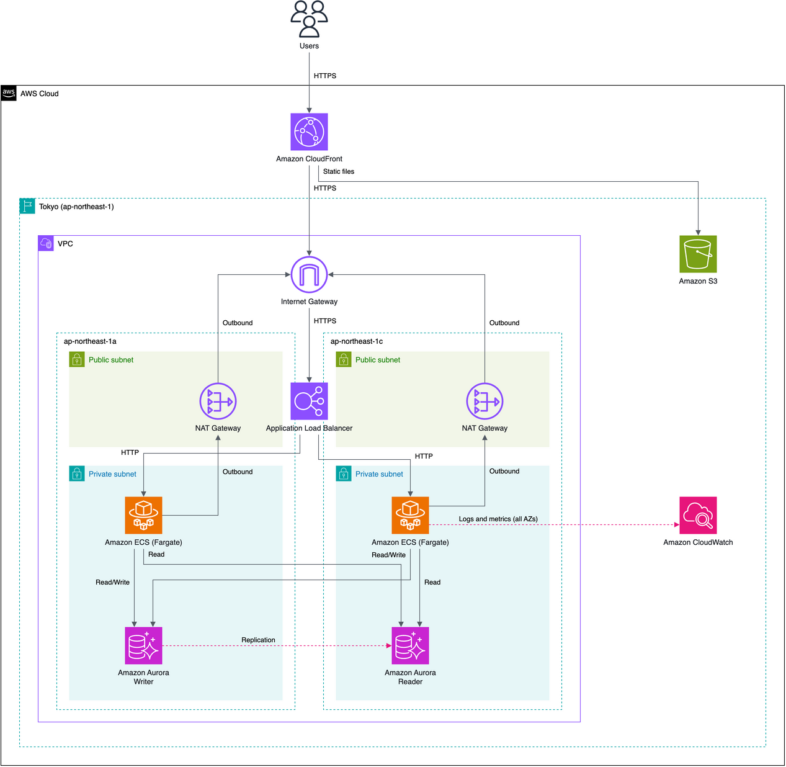
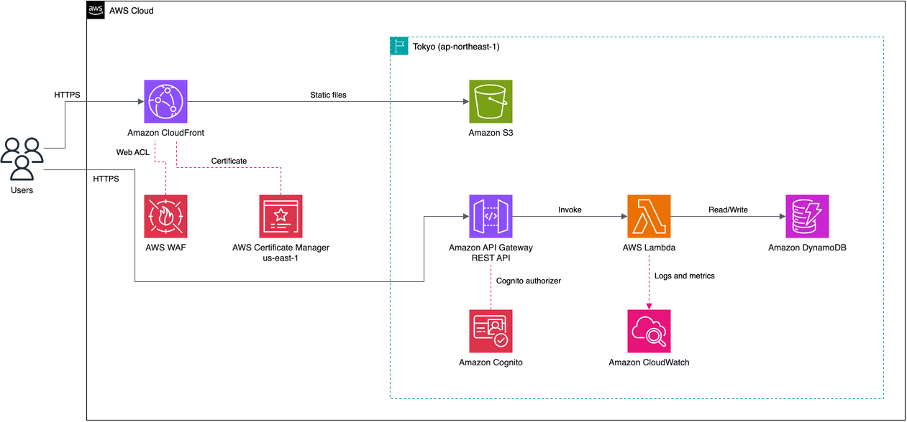

# archwire

archwire turns a short definition of how services connect into a draw.io diagram for AWS architectures. It works by rules, not by an AI. The same definition always gives the same diagram, byte for byte, on macOS and Linux. Every part or setting archwire adds on its own carries a reason, and where the connections alone cannot decide the architecture, archwire reports a hole and asks instead of guessing.

archwire is not an official AWS tool and is not affiliated with Amazon Web Services.

## Example

Save this as `web.yaml`:

```yaml
flows:
  - user -> cloudfront -> alb -> ecs(fargate) -> aurora
  - cloudfront -> s3
  - ecs -> internet
  - ecs ~> cloudwatch
```

```sh
archwire compile web.yaml -o web.drawio
```

The command writes `web.drawio` and prints a JSON report. The exit code is 0. This is what the diagram looks like:



Four lines of definition produced the VPC, the Internet Gateway, the public and private subnets, the second Availability Zone, the NAT gateways, and the Aurora writer and reader. None of them were written in the definition. Each has a reason in the report, and the same reason is stored on the part inside the `.drawio` file (see [Reading the report](#reading-the-report)).

In this example these elements carry a reason: the AWS Cloud frame, the Region frame, the VPC frame, both Availability Zone frames, all four subnet frames, the Internet Gateway, both NAT gateways, and the parts whose place archwire chose (CloudFront, ECS, Aurora, S3 and CloudWatch). The users and the load balancer carry none.

### An API without a VPC

A definition that writes no VPC service is drawn without a VPC, from left to right. Save this as `api.yaml`:

```yaml
flows:
  - user -> cloudfront -> s3
  - user -> apigateway(rest) -> lambda -> dynamodb
  - cognito -- apigateway
  - lambda ~> cloudwatch
  - waf -- cloudfront
  - acm -- cloudfront
set:
  lang: en
```

```sh
archwire compile api.yaml -o api.drawio
```

The exit code is 0. This is the diagram:



The line from Cognito is labelled "Cognito authorizer" because the API is a REST API; with `apigateway(http)` it reads "JWT authorizer". Certificate Manager carries `us-east-1` under its name. The report gives the reasons for the AWS Cloud and Region frames, the Region, the place of each part, and the authorizer. This definition and its expected output are the acceptance case `tests/cases/api-rest-en`.

## Install

archwire is a Rust program. With a recent stable Rust toolchain, from a checkout of this repository:

```sh
cargo install --path crates/archwire
```

## Use

```sh
archwire compile <definition> -o <diagram.drawio>
archwire set <definition> <place> <value>
```

`compile` reads the definition, writes the diagram, and prints the report as JSON on standard output. If the definition has errors, no diagram is written, and a file left at the `-o` path by an earlier compile is removed, so an old diagram is never mistaken for the result.

`set` rewrites one place in a definition file and leaves every other line, comment and line ending as it was. It prints nothing when it succeeds; when it fails, it prints a report with the error and exits with 1. The place is `flows[i][j]` (the j-th part of the i-th flow line, counting from 0), `set.<key>`, or `choose.<hole id>`. For example, to use three Availability Zones in `web.yaml`:

```sh
archwire set web.yaml set.azs 3
```

The definition language is described in [docs/definition.md](docs/definition.md).

### Exit codes

| Code | Meaning |
|---|---|
| 0 | The diagram was written and nothing is left undecided. |
| 1 | The definition or a file has an error. No diagram is written. The report is still printed. |
| 2 | The diagram was written, but at least one hole is left. |

### Holes

A hole is a decision the connections alone cannot make. In this version there are two kinds.

The first is the route out of a VPC. When a main flow goes from a part inside the VPC's private subnets to a Regional service outside the VPC, such as `ecs -> s3`, the traffic can leave through a VPC endpoint or through a NAT gateway, and archwire does not pick. Save this as `hole.yaml` and compile it:

```yaml
flows:
  - user -> alb -> ecs
  - ecs -> s3
```

```sh
archwire compile hole.yaml -o hole.drawio
```

The exit code is 2. The report contains:

```json
"holes": [
  {
    "hole": "route.ecs.s3",
    "at": "flows[1]",
    "need": "Route from ecs to s3",
    "choices": [
      "endpoint",
      "nat"
    ]
  }
]
```

The diagram is still written. The undecided line is drawn grey and dashed with the label "Route undecided". Answer the hole with `set`:

```sh
archwire set hole.yaml choose.route.ecs.s3 endpoint
```

This adds a `choose:` section to the definition with `route.ecs.s3: endpoint`. Compile again and the exit code is 0. With `nat` instead, archwire adds NAT gateways. With `endpoint` it adds no icon and notes that endpoint icons are not drawn, and the line's label says "(via VPC endpoint)".

The second is the kind of API Gateway. `apigateway` written without `(http)` or `(rest)` leaves the hole `kind.apigateway`, with the choices `http` and `rest`. Save this as `api-hole.yaml`:

```yaml
flows:
  - user -> apigateway -> lambda
```

`archwire compile api-hole.yaml -o api-hole.drawio` exits with 2, and the API Gateway reads "type undecided" under its name. Answer with `archwire set api-hole.yaml choose.kind.apigateway http`, or write `apigateway(http)` in the definition, but not both. Compile again and the exit code is 0. See [docs/definition.md](docs/definition.md#the-kind-of-api-gateway).

## Reading the report

The report is one JSON object with these fields.

`versions` holds the archwire version and the version of the rules data. `derived` lists everything archwire added or decided by itself. Each entry has the part it applies to (`target`), `added` (true when the target is something archwire added, such as a frame, the Internet Gateway or a NAT gateway; false when the reason places a part the definition wrote, such as ECS in a private subnet), whether the reason is a `constraint` or a `default`, the rule id, the reason in the language chosen by `set.lang`, and for constraints the AWS documentation page that states it. `holes` lists the open decisions, as above. `errors` lists what stopped the compile, each with a `code`, the place `at`, the value `got`, the values `allowed` where there is a fixed list, and a `message`. `notes` carries plain remarks about the drawing. When a line could not be drawn clear of every icon, text and other line, or its label could not be placed clear of every icon, text and other line, a note names the line (such as `edge-alb-to-s3`) so you can look at it. A line's label may lie over the side of a frame when no spot clear of frame sides is left; the text stays readable, so that gets no note. In a diagram without a VPC, when several parts of one service send the same auxiliary flow (`~>`) or association (`--`) to one part, the diagram draws one line labelled with the count, such as "Logs and metrics (3 sources)", and a note names the parts it stands for.

`warnings` is part of the format and is not used in this version: it is always empty. The `rule` field of an error is `null`, except for `TOO_MANY_ATTACHED`, where it names the rule the definition breaks.

A constraint comes from AWS documentation. A default is archwire's own choice for something the definition did not say, such as using two Availability Zones or placing ECS in private subnets. A default is not an AWS requirement. The report and the diagram both say which is which.

The reasons are not only in the report. Every element with a reason carries it inside the `.drawio` file, as the attributes `derived` (the reason text), `rule`, `kind` and `source` on the cell, so they travel with the diagram. When an element has more than one reason, each attribute holds them in the same order, separated by ` | `. Every cell archwire added, that is every frame and the Internet Gateway and NAT gateways, also has the attribute `added="1"`; cells for parts the definition wrote do not, even when they carry a reason for where they were placed. The error codes are listed in [docs/definition.md](docs/definition.md#errors), and the rules in [docs/rules.md](docs/rules.md).

## What this version draws

Two shapes. Which one is drawn follows from the services the definition writes.

The first is a Web architecture with one VPC with two or three Availability Zones, an Application Load Balancer in the public subnets, ECS in private subnets, and optionally Aurora, with the other services in `rules/aws/services.toml`: users, the internet (outbound only), CloudFront, WAF and Certificate Manager (both only attached to CloudFront), S3 and CloudWatch. The Internet Gateway and NAT gateways are added by archwire and cannot be written in a definition.

Such a definition must have a main flow from `user` or `cloudfront` into `alb`, and from `alb` into `ecs`. Which other connections are accepted is listed in [docs/definition.md](docs/definition.md#which-connections-are-accepted-with-a-vpc).

The second is an API without a VPC: users, CloudFront with WAF and Certificate Manager attached, S3, API Gateway as an HTTP API or a REST API, Lambda, DynamoDB, Cognito attached to API Gateway, and CloudWatch, drawn from left to right. Parts of one service can be told apart with a name after a dot, such as `s3.web` and `s3.uploads`. The accepted connections are listed pair by pair in `rules/aws/links.toml` and in [docs/definition.md](docs/definition.md#which-connections-are-accepted-without-a-vpc).

In both shapes the only Region is `ap-northeast-1`, and labels are in English, or in Japanese with `set.lang`. A connection or shape not described here stops with the error `UNSUPPORTED` instead of producing a diagram that is wrong.

## What this version does not do

It cannot yet draw a definition that mixes VPC services (`alb`, `ecs`, `aurora`) with `apigateway`, `lambda`, `dynamodb` or `cognito`; such a definition stops with `UNSUPPORTED`. Names after a dot are accepted only in definitions without a VPC.

It does not draw the endpoint types of API Gateway (edge-optimized, Regional, private) or WebSocket APIs. It does not attach WAF to API Gateway; `waf` attaches only to `cloudfront`. Which API types support AWS WAF is in the AWS comparison [Choose between REST APIs and HTTP APIs](https://docs.aws.amazon.com/apigateway/latest/developerguide/http-api-vs-rest.html). It does not draw a sign-in line from users to Cognito; Cognito is drawn only attached to API Gateway. A definition cannot choose the direction of the diagram.

It does not draw queues, topics, event buses, workflows or AI services, more than one VPC, Transit Gateway, on-premises networks, several accounts, or other clouds. It does not simulate failures, show migration stages, compare a diagram with Terraform, or read a `.drawio` file back into a definition.

A diagram that compiles means it is consistent under these rules. It does not mean the architecture is guaranteed to work in AWS.

## Checking the cases

`cargo test --workspace` compiles every definition under `tests/cases` and compares the output with the expected files byte for byte. `python3 tools/geocheck.py --self-test` runs the self-test of the diagram checker and needs neither draw.io nor a diagram.

`sh tools/check_cases.sh` checks each expected diagram as draw.io renders it and writes images to `out/`. It needs the draw.io desktop command line (`drawio`) and Python with Pillow. `tools/geocheck.py` exits with 1 when a diagram has a blocking fault (a line over text, a line over an icon, two lines on top of each other, two icons or two texts overlapping, or an icon or its text outside its frame), and with 2 when it could not read the rendering, which says nothing about the diagram.

`tools/known_findings.txt` lists findings that are known and do not fail `check_cases.sh`, one per line as `<case> <kind> <finding>`. A finding in the list that no longer appears fails the check, so the list cannot go stale. The list is empty today.

The layout without a VPC is also tested on definitions made by a program, which vary the number of branches, shared targets, auxiliary flows, named parts, several CloudFront distributions and the language. `cargo test --workspace` lays out every one of them and checks that each is laid out without `LAYOUT_FAILED` (no parts or names overlapping, every part in its frame) and that no line or label is reported as not drawn clear. To check 40 of them as draw.io renders them, write them out and run the checker:

```sh
ARCHWIRE_GEN_OUT=out/gen cargo test -p archwire-core generated
sh tools/check_generated.sh out/gen
```

`check_generated.sh` exits with 0 when every diagram passes, 1 when a diagram has a blocking fault or is missing, and 2 when `drawio` is not on PATH.

Continuous integration runs `cargo test --workspace` and the checker's self-test on Linux and macOS. It does not render diagrams, because that needs the draw.io desktop app, so the rendered-diagram check is run locally with `sh tools/check_cases.sh`.

## License

Apache License 2.0, see [LICENSE](LICENSE). Where some of the style strings, colors and shape names come from is in [NOTICE](NOTICE).
